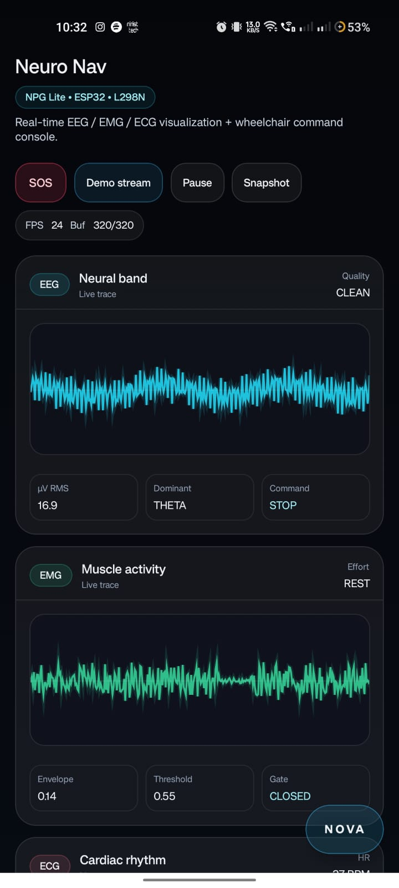
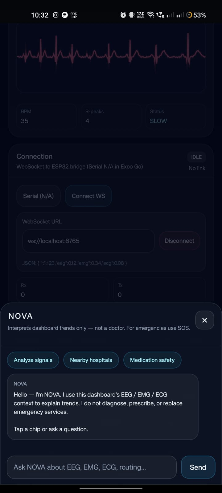
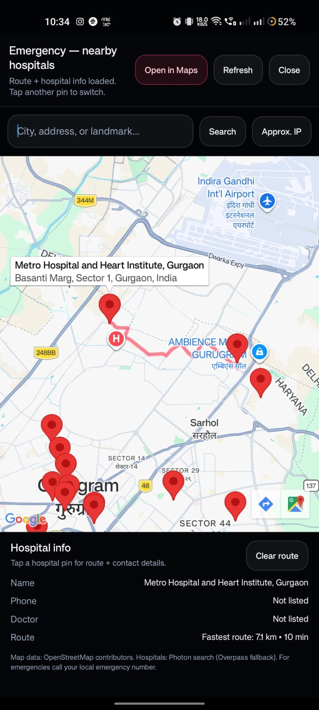

# 🧠 Neuro-Nav-App


> AI-powered medical navigation and analysis mobile application built using React Native (Expo)

---

## 📸 Screenshots

<p align="center">
  
  
  
</p>

---

## 🚀 Overview

Neuro-Nav-App is a mobile application designed to assist in intelligent medical data navigation and visualization. It provides a clean interface and is structured to support AI-driven insights and backend integrations.

---

## ✨ Features

- 🧠 AI-ready architecture
- 📱 Cross-platform (Android & iOS via Expo)
- ⚡ Fast and responsive UI
- 📊 Visual output support
- 🔗 Backend integration ready

---

## 🛠️ Tech Stack

**Frontend**
- React Native (Expo)
- TypeScript
- React Hooks

**Libraries Used**
- expo-linear-gradient
- expo-clipboard
- expo-status-bar
- @react-native-picker/picker

**Backend (Optional)**
- Flask / FastAPI / Node.js

---

## 📂 Project Structure
Neuro-Nav-App/
│── assets/
│── images/
│── components/
│── src/
│── App.tsx
│── package.json
│── tsconfig.json
│── app.json


---

## ⚙️ Installation

```bash
git clone https://github.com/shivangsaxena2211/Neuro-Nav-App.git
cd Neuro-Nav-App
npm install

▶️ Run the App
npx expo start
Tunnel mode (if needed)
npx expo start --tunnel

📱 Running on Device
Install Expo Go
Scan QR code
Or press:
a → Android
i → iOS

🧠 Architecture
User Input
   ↓
React Native App
   ↓
State Management / Logic
   ↓
Backend API (Optional)
   ↓
AI Processing
   ↓
Output Visualization

🔮 Future Improvements
AI model integration
Authentication system
Cloud deployment
Real-time sync
Better UI/UX

🤝 Contributing
git checkout -b feature-name
git commit -m "Added feature"
git push origin feature-name


👨‍💻 Author

Shivang Saxena
https://github.com/shivangsaxena2211

⚠️ Disclaimer

This project is for educational purposes only and is not intended for real medical use.
