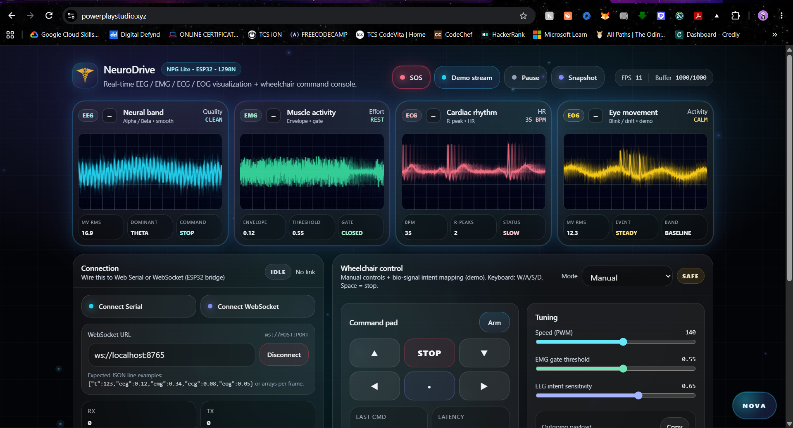
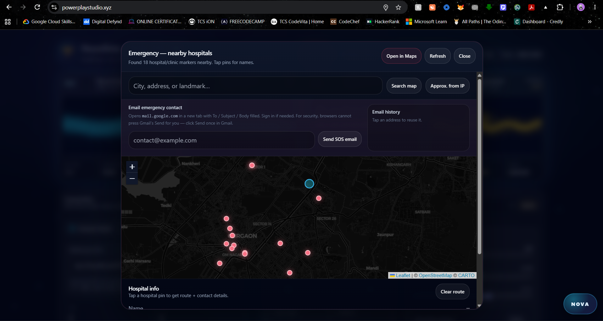
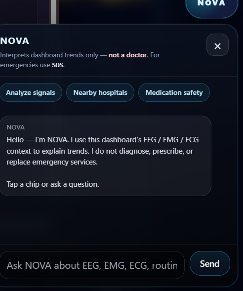
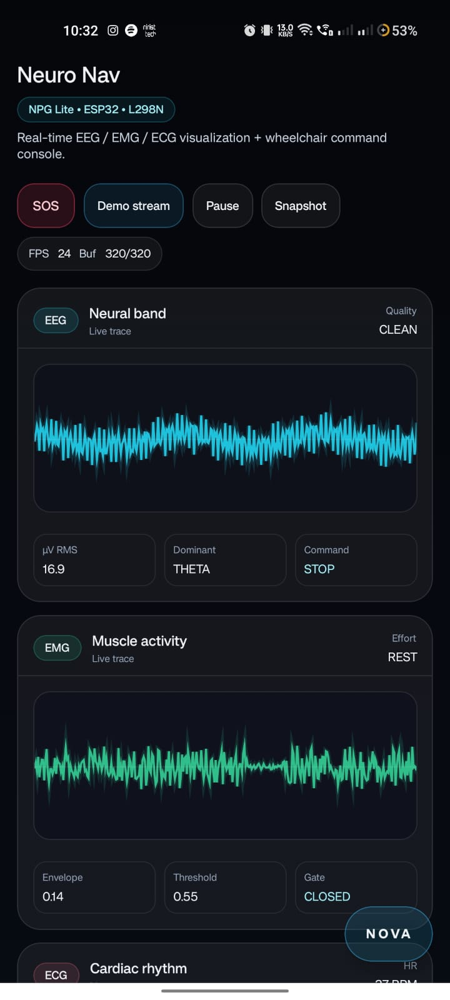
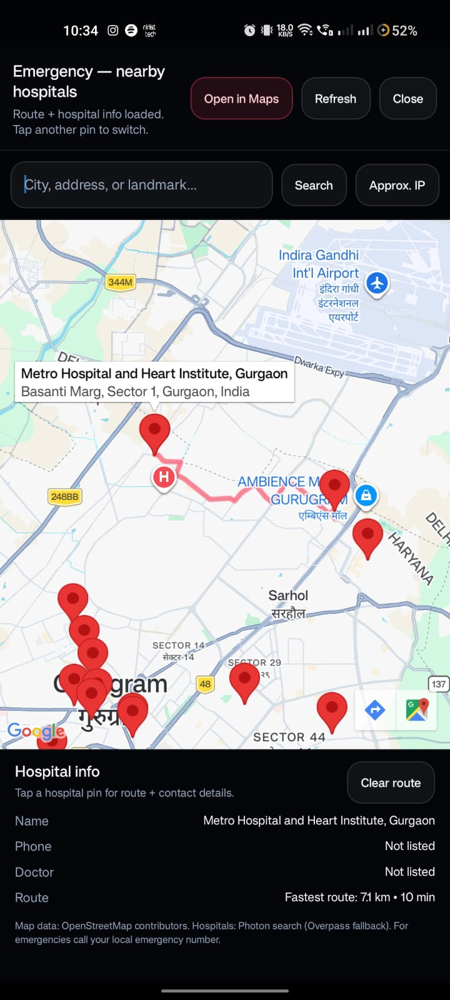
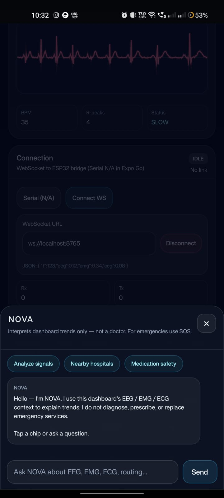
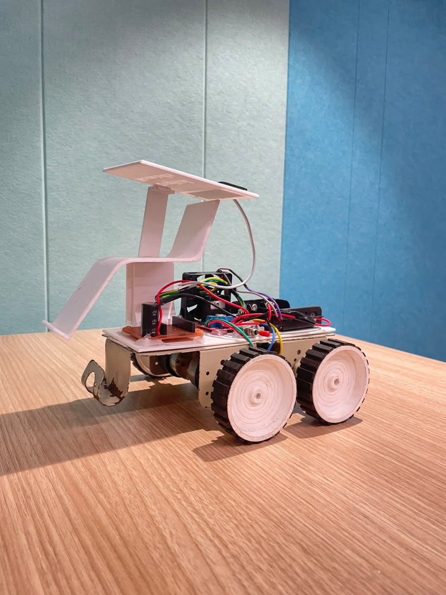
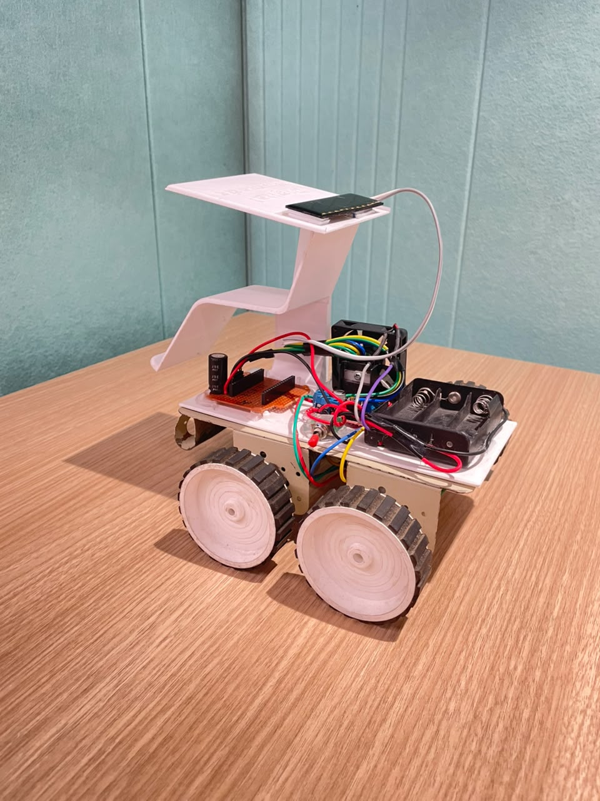

#                                                🧠 Neuro-Nav

### BCI and HCI Based Navigation & Assistive Mobility System

<p align="justify">
  <b>Neuro-Nav</b> is an intelligent assistive mobility platform that combines biomedical signal monitoring, embedded systems, a mobile application, and a real-time web dashboard to create a technology-driven navigation and vehicular-control ecosystem.
</p>

<p align="center">
  

  

  

  

  

  

  

  
</p>

---

## 📌 Overview

**Neuro-Nav** is a multidisciplinary assistive-technology product designed around the concept of intelligent navigation and mobility assistance.

The system brings together:

* 🧠 Biomedical signal monitoring
* 📱 Cross-platform mobile application
* 🌐 Real-time web dashboard
* 🤖 ESP32-based embedded control
* ♿ Smart wheelchair command interface
* 📊 EEG, EMG and ECG signal visualization
* 🔌 WebSocket-based communication
* ⚡ Real-time system interaction

This repo is structured as a modular ecosystem so that the mobile application, embedded hardware and web dashboard can be developed and tested independently while being integrated into a common assistive-navigation platform.

---

# 🎯 Objectives

The primary objectives of Neuro-Nav are:

1. To develop an intelligent assistive mobility platform.
2. To provide real-time visualization of biomedical signals.
3. To create an interface for controlling an ESP32-based mobility system.
4. To establish communication between software and embedded hardware.
5. To provide a user-friendly mobile application.
6. To create a browser-based monitoring and control dashboard.
7. To provide an architecture that can be extended with real biomedical sensors and AI/ML models.

---

# 🏗️ System Architecture

```text
                 ┌──────────────────────┐
                 │   Biomedical Sensors │
                 │ EEG / EMG / ECG      │
                 └──────────┬───────────┘
                            │
                            ▼
                 ┌──────────────────────┐
                 │     ESP32-C6 /       │
                 │ Embedded Controller  │
                 └──────────┬───────────┘
                            │
                  Wireless / WebSocket
                            │
             ┌──────────────┴──────────────┐
             │                             │
             ▼                             ▼
   ┌──────────────────┐          ┌──────────────────┐
   │   Web Dashboard  │          │   Mobile App     │
   │                  │          │                  │
   │ EEG / EMG / ECG  │          │ React Native     │
   │ Visualization    │          │ Expo             │
   │                  │          │ TypeScript       │
   │ Wheelchair       │          │                  │
   │ Control          │          │ AI-ready UI      │
   └────────┬─────────┘          └──────────────────┘
            │
            ▼
   ┌──────────────────────┐
   │ Intelligent Mobility │
   │ / Wheelchair System  │
   └──────────────────────┘
```

---

# ✨ Key Features

## 🧠 Biomedical Signal Monitoring

The web dashboard is designed to visualize three major biomedical signal categories:

* **EEG** — Electroencephalography
* **EMG** — Electromyography
* **ECG** — Electrocardiography

The current dashboard includes a demonstration stream that allows the interface to be tested without requiring physical biomedical sensors.

---

## ♿ Smart Wheelchair Control

Neuro-Nav provides a control interface for an ESP32-powered wheelchair/mobility platform.

The dashboard supports keyboard-based commands:

| Key     | Command        |
| ------- | -------------- |
| `W`     | Forward        |
| `A`     | Left           |
| `S`     | Reverse        |
| `D`     | Right          |
| `Space` | Emergency Stop |

The control interface includes an **Arm** mechanism to prevent accidental command transmission.

---

## 📊 Real-Time Dashboard

The browser-based dashboard provides:

* Live signal visualization
* EEG monitoring
* EMG monitoring
* ECG monitoring
* Demo signal generation
* Wheelchair command interface
* WebSocket connectivity
* Modern responsive interface

The dashboard is designed to work with future real biomedical sensor integrations.

---

## 📱 Mobile Application

The Neuro-Nav mobile application is developed using:

* React Native
* Expo
* TypeScript
* React Hooks

The application provides an AI-ready architecture for intelligent medical-data navigation and visualization and is designed for cross-platform deployment on Android and iOS.

---

# 🔌 Hardware

The embedded portion of Neuro-Nav uses an **ESP32-C6** controller.

Current repository components include:

```text
ESP-32 C6_ESP/
└── Neuro-nav/
    ├── Neuronav_Receiver_esp32__car_.ino
    ├── app.js
    ├── index.html
    ├── styles.css
    ├── logo.png
    └── README.md
```

The ESP32 component is intended to act as the embedded communication/control layer for the mobility system.

---

# 💻 Software Components

The complete project is divided into three primary modules:

```text
Neuro_Nav/
│
├── Application/
│   └── Neuro-Nav-App/
│
├── ESP-32 C6_ESP/
│   └── Neuro-nav/
│
├── Web_Dash/
│   └── Neuro-Nav-Web/
│
└── LICENSE
```

---

# 📱 1. Neuro-Nav Mobile Application

### Technologies

* React Native
* Expo
* TypeScript
* React Hooks
* Expo Linear Gradient
* Expo Clipboard
* Expo Status Bar
* React Native Picker

### Directory

```text
Application/
└── Neuro-Nav-App/
    ├── assets/
    ├── components/
    ├── images/
    ├── src/
    ├── App.tsx
    ├── app.json
    ├── index.ts
    ├── package.json
    └── tsconfig.json
```

### Installation

```bash
cd Application/Neuro-Nav-App
npm install
```

### Start Development Server

```bash
npx expo start
```

For tunnel mode:

```bash
npx expo start --tunnel
```

The existing application documentation also supports running the application through Expo Go on a mobile device.

---

# 🌐 2. Neuro-Nav Web Dashboard

The web dashboard provides the monitoring and control interface for Neuro-Nav.

### Technologies

* HTML5
* CSS3
* JavaScript
* WebSocket
* ESP32

### Directory

```text
Web_Dash/
└── Neuro-Nav-Web/
    ├── index.html
    ├── app.js
    ├── styles.css
    ├── logo.png
    └── README.md
```

The dashboard is browser-based and does not currently require a package installation.

### Run

Navigate to:

```bash
cd Web_Dash/Neuro-Nav-Web
```

Then open:

```text
index.html
```

using a modern browser such as:

* Google Chrome
* Microsoft Edge
* Brave

---

# 🔧 3. ESP32-C6 Module

Navigate to:

```bash
cd "ESP-32 C6_ESP/Neuro-nav"
```

The primary firmware file is:

```text
Neuronav_Receiver_esp32__car_.ino
```

Upload the firmware to the ESP32-C6 using the **Arduino IDE** or an appropriate ESP32 development environment.

> **Note:** Pin assignments, communication parameters and motor-driver configuration should be verified against the actual hardware before deployment.

---

# 🔄 Communication Flow

Neuro-Nav is designed around real-time communication between sensing, processing and control components.

```text
Biomedical Data
       │
       ▼
    ESP32-C6
       │
       │ WebSocket / Communication Layer
       ▼
 Web Dashboard
       │
       ├── EEG
       ├── EMG
       └── ECG
       │
       ▼
Visualization & Control
       │
       ▼
Mobility System
```

The dashboard supports incoming JSON messages such as:

```json
{
  "t": 123,
  "eeg": 0.12,
  "emg": 0.34,
  "ecg": 0.08
}
```

It can also accept batched signal arrays:

```json
{
  "t": 123,
  "eeg": [],
  "emg": [],
  "ecg": []
}
```

This communication structure is already documented in the embedded dashboard implementation.

---

# 🧪 Demo Mode

Neuro-Nav includes a simulated biomedical-signal stream.

This makes it possible to test:

* Dashboard visualization
* Signal rendering
* User interface
* Control interface
* Communication logic

without immediately requiring physical EEG, EMG or ECG sensors.

---

# 🚀 Getting Started

## Step 1 — Clone Repository

```bash
git clone https://github.com/techophile05/Neuro_Nav.git
```

## Step 2 — Enter Project

```bash
cd Neuro_Nav
```

## Step 3 — Mobile Application

```bash
cd Application/Neuro-Nav-App
npm install
npx expo start
```

## Step 4 — Web Dashboard

Open:

```text
Web_Dash/Neuro-Nav-Web/index.html
```

in a modern browser.

## Step 5 — ESP32

Open:

```text
ESP-32 C6_ESP/Neuro-nav/Neuronav_Receiver_esp32__car_.ino
```

in Arduino IDE and upload it to the ESP32-C6 after configuring the appropriate board, port and hardware connections.

---

# 🛠️ Technology Stack

| Layer               | Technology      |
| ------------------- | --------------- |
| Mobile Application  | React Native    |
| Mobile Framework    | Expo            |
| Mobile Language     | TypeScript      |
| Web Dashboard       | HTML5           |
| Dashboard Styling   | CSS3            |
| Dashboard Logic     | JavaScript      |
| Communication       | WebSocket       |
| Embedded Controller | ESP32-C6        |
| Firmware            | Arduino / C++   |
| Biomedical Signals  | EEG / EMG / ECG |
| Version Control     | Git & GitHub    |

---

# 🔮 Future Scope

Neuro-Nav is designed as an extensible platform. Potential future improvements include:

### 🧠 AI-Based Intent Detection

Machine-learning models could be introduced to interpret biomedical signals and map detected patterns to navigation commands.

```text
EEG / EMG
    ↓
Signal Preprocessing
    ↓
Feature Extraction
    ↓
AI / ML Model
    ↓
Intent Classification
    ↓
Navigation Command
```

### 📡 Real Sensor Integration

Future versions can integrate physical:

* EEG sensors
* EMG sensors
* ECG sensors
* IMU
* Distance sensors
* Environmental sensors

### 🤖 Autonomous Navigation

The platform can potentially be extended with:

* Obstacle detection
* Path planning
* Autonomous navigation
* Sensor fusion
* GPS-based navigation
* Computer vision
* SLAM

### ☁️ Cloud Integration

Future releases could introduce:

* Remote monitoring
* Cloud data storage
* User accounts
* Historical signal analysis
* Analytics dashboards
* Remote diagnostics

### 📱 Advanced Mobile Features

Possible improvements include:

* Authentication
* Real-time synchronization
* AI-assisted analysis
* Cloud connectivity
* Improved accessibility
* Personalized user profiles

The mobile application's existing roadmap already identifies AI integration, authentication, cloud deployment, real-time synchronization and UI/UX improvements as future directions.

---

# ⚠️ Safety & Medical Disclaimer

**Neuro-Nav is an educational and research-oriented project.**

The current implementation should **not be considered a certified medical device, medical diagnostic system, or safety-critical mobility controller.**

Biomedical data shown by the demo system may be simulated and should not be interpreted as medical information.

Before using any future hardware implementation with a real person or mobility device, appropriate:

* Hardware validation
* Software testing
* Electrical safety testing
* Biomedical validation
* Fail-safe mechanisms
* Regulatory compliance
* Clinical evaluation

should be completed.

---

# 🤝 Contributing

Contributions are welcome.

### 1. Fork the repository

```bash
git fork https://github.com/techophile05/Neuro_Nav
```

### 2. Create a branch

```bash
git checkout -b feature/your-feature
```

### 3. Make your changes

```bash
git add .
```

### 4. Commit

```bash
git commit -m "Add your feature"
```

### 5. Push

```bash
git push origin feature/your-feature
```

### 6. Open a Pull Request

Please provide a clear description of the changes and their purpose.

---

# 📁 Complete Repository Structure

```text
Neuro_Nav/
│
├── Application/
│   └── Neuro-Nav-App/
│       ├── assets/
│       ├── components/
│       ├── images/
│       ├── src/
│       ├── App.tsx
│       ├── app.json
│       ├── index.ts
│       ├── package.json
│       └── tsconfig.json
│
├── ESP-32 C6_ESP/
│   └── Neuro-nav/
│       ├── Neuronav_Receiver_esp32__car_.ino
│       ├── app.js
│       ├── index.html
│       ├── styles.css
│       ├── logo.png
│       └── README.md
│
├── Web_Dash/
│   └── Neuro-Nav-Web/
│       ├── index.html
│       ├── app.js
│       ├── styles.css
│       ├── logo.png
│       └── README.md
│
├── LICENSE
└── README.md
```

---

# 📜 License

This project is licensed under the **MIT License**.

See the [`LICENSE`](./LICENSE) file for details.

---

# 👨‍💻 Project

**Neuro-Nav**

An experimental intelligent navigation and assistive mobility platform integrating:

> 🧠 Biomedical Signals + 🤖 Embedded Systems + 📱 Mobile Application + 🌐 Real-Time Dashboard

---

<p align="justify">
  <b>Built for innovation in assistive technology, intelligent mobility and human-machine interaction.</b>
</p>

<p align="justify">
  ⭐ If you find this project interesting, consider starring the repository!
</p>


Core Team<br>
Pranjal Sood   (Bachelor of Technology-CSE) <br>
Shivang Saxena (Bachelor of Technology-CSE) <br>
Kanishk Gulati (Bachelor of Technology-CSE) <br>
Vansh Agarwal  (Bachelor of Technology-CSE) <br>
 